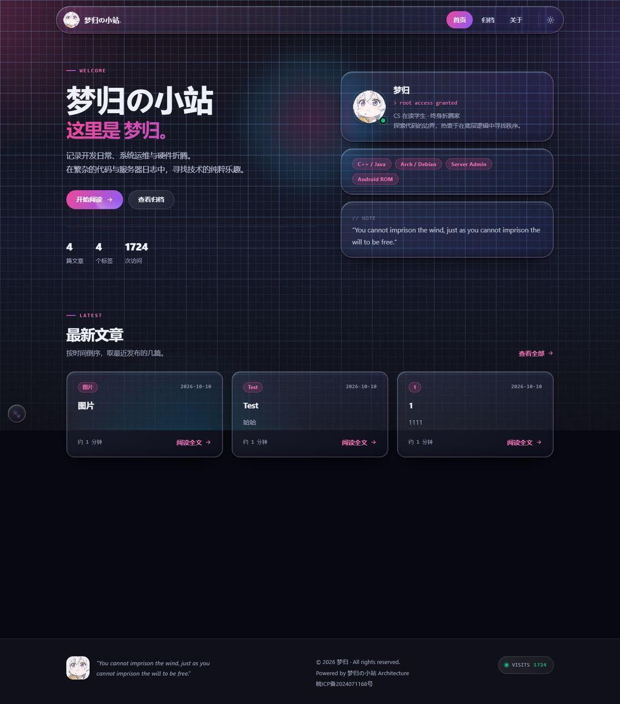
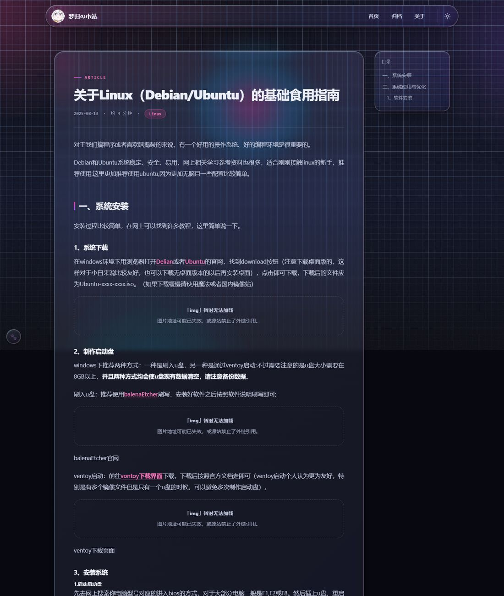
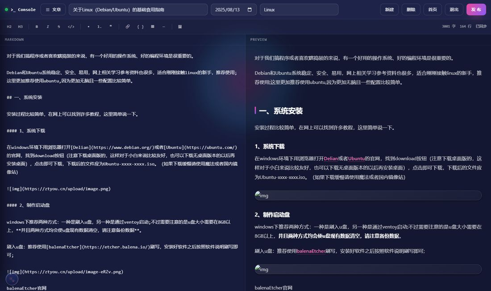

# 🌌 Single-File-MD-Blog

一个**零数据库**的极简单文件 Markdown 博客：所有文章存在 `blogs/default.md` 里，
评论存在 `comments/` 里，不需要 MySQL，**备份博客 = 复制一个文件夹**。

- 前端：动态极光 + 玻璃拟态、白天/黑夜（按系统时间自动切换）、文章页目录与阅读进度
- 评论：自己实现，存文件、带审核、有防灌水，**不依赖任何第三方服务**
- 看板娘：桌面端 Live2D 伊蕾娜，默认关闭，点左下角 🐾 唤出







---

## 环境要求

| | |
| --- | --- |
| PHP | **8.0+**，需要 `mbstring`、`json`；图床上传还需要 `fileinfo` |
| Web 服务器 | Nginx / OpenResty / Apache 都行（下面给的是 Nginx 配置） |
| 不需要 | 数据库、Node.js、任何构建步骤 |

## 快速开始

### 方式一：一条命令（推荐）

```bash
git clone https://github.com/mengguizzz/SFMblog && cd SFMblog
bash install.sh
```

不想克隆也可以直接在空目录里跑：

```bash
curl -fsSL https://cdn.jsdelivr.net/gh/mengguizzz/SFMblog@main/install.sh | bash
```

> 这里特意用的是 **jsDelivr** 而不是 `raw.githubusercontent.com` —— 后者在国内很多网络下直接连不上
> （实测连接超时），jsDelivr 能通。网络好的话两者都行，脚本自己也会在
> `codeload.github.com` 和 `api.github.com` 之间自动换线路下载代码。

想直接带参数跑（管道进去时要加 `bash -s --`）：

```bash
curl -fsSL https://cdn.jsdelivr.net/gh/mengguizzz/SFMblog@main/install.sh | bash -s -- --dir=/var/www/blog
```

> jsDelivr 会缓存分支文件。改了 `install.sh` 之后如果发现拉到的还是旧的，
> 访问一次 <https://purge.jsdelivr.net/gh/mengguizzz/SFMblog@main/install.sh> 就能刷掉缓存。

它会**问你要装到哪个目录、后台密码设什么**（密码直接回车就是随机生成一个），然后：
检查 PHP 版本与扩展 → 放好文件 → 生成 `config.php`（bcrypt 哈希）→
把 `blogs/`、`comments/` 设成 750 → 打印怎么启动。

想少回答问题就加参数，全部可用参数在 `bash install.sh --help`：

```bash
bash install.sh --dir=/var/www/blog          # 直接指定目录，不问
bash install.sh --password='你的密码'         # 直接指定密码，不问
bash install.sh --dir=/var/www/blog --nginx  # 顺手写一份 nginx 配置并 reload
bash install.sh --serve                      # 装完直接用 php -S 起本地预览
bash install.sh -y                           # 全默认，一个问题都不问
```

> 装完想立刻看看效果，用 `--serve`（或者手动 `cd 目录 && php -S 127.0.0.1:8080`）。
> PHP 自带的这个服务器只是给你本地预览的，**它不会挡 `blogs/` 和 `comments/`**，
> 别拿它对外提供服务 —— 对外的站点请用下面的 Nginx 配置。

### 方式二：手动装（想知道每一步在干什么）

#### 1. 把文件放上去

下载本仓库，整个目录丢到站点根目录（示例用 `/var/www/sfmblog`）。

#### 2. 生成管理员密码

```bash
php tools/make-password.php '你的新密码'
```

会输出一串 bcrypt 哈希，复制下来备用。

> 不要用 `sha256sum` 自己算 —— sha256 太快了，拿到哈希可以暴力破解。
> 这个脚本用的是 bcrypt（cost 12），慢得多。

#### 3. 写配置文件

把 `config.example.php` 复制成 **`config.php`**，填上刚才那串哈希：

```php
<?php
$EXPECTED_HASH = '$2y$12$....';   // tools/make-password.php 的输出
```

`config.php` 已经在 `.gitignore` 里，不会被提交。
**没配置的话，登录页会明确提示「服务端还没配置密钥指纹」**，不会静默放行。

同一个文件里还能改评论的审核开关（不写就用默认值）：

```php
$COMMENT_MODERATE = true;    // 评论是否先进待审核（默认 true）
```

#### 4. 给目录写权限

```bash
chown -R www-data:www-data blogs src/images comments
chmod 750 blogs comments          # 里面是文章原文和评论，别让同机器的其它用户读到
```

`src/images/` 是图床上传目录，第一次上传时会自动创建。

> 💡 **用 1Panel / 宝塔这类面板建的站**，很容易踩到这个：
> 面板把站点目录建成 `root:root`，而 PHP-FPM 跑在**另一个用户**下
> （1Panel 的 PHP 容器里是 `uid 1000`，在宿主机上就是 `1panel`；有的面板是 `www` 或 `www-data`）。
> 结果 `blogs/`、`comments/`、`src/images/` 全是"只读不可写"，症状是
> **登录看着成功、一点「编辑此文」就被踢回登录页，访问量永远停在 0**
> —— 因为会话文件和计数器都写不进去。
>
> 问 PHP 它是谁：在站点里放个临时 php 打印 `posix_getuid()`，或者直接跑
> `tools/doctor.sh`（第 4 步就会告诉你写不进去，并把该执行的 `chown` 打出来）。
> 记住**只给数据目录写权限，代码文件保持只读** —— 这样即使哪天 PHP 层被打穿，也改不了自己的代码。

#### 5. Nginx 参考配置

```nginx
server {
    listen 80;
    server_name your.domain.com;

    root /var/www/sfmblog;
    index index.html;
    charset utf-8;
    client_max_body_size 12m;              # 图床上传上限

    # 这些目录/文件是数据，永远不对外
    location ^~ /blogs/    { deny all; }
    location ^~ /comments/ { deny all; }
    location = /config.php { deny all; }
    location ~ /\.         { deny all; }
    location ~* \.(bak|tmp)$ { deny all; }

    # 安全响应头（按需增删）
    add_header Content-Security-Policy "default-src 'self'; script-src 'self' 'unsafe-inline' https://cdn.jsdelivr.net; style-src 'self' 'unsafe-inline' https://cdn.jsdelivr.net; img-src 'self' data: https:; font-src 'self' data:; connect-src 'self' https://cdn.jsdelivr.net https://v1.hitokoto.cn; worker-src 'self' blob:; frame-ancestors 'none'; base-uri 'self'; form-action 'self'" always;
    add_header X-Content-Type-Options nosniff always;
    add_header Referrer-Policy same-origin always;

    location / { try_files $uri $uri/ =404; }

    location ~ \.php$ {
        include snippets/fastcgi-php.conf;
        fastcgi_pass unix:/run/php/php8.5-fpm.sock;   # 按实际版本改
        fastcgi_read_timeout 120s;
    }

    location ~* \.(jpg|jpeg|png|gif|webp|svg|css|js|ico|woff2?)$ {
        expires 7d;
        add_header Cache-Control "public";
    }
}
```

改完 `nginx -t && systemctl reload nginx`。

> **部署完先跑一次体检**，让它直接告诉你哪里不对（文件权限、能不能写入、
> `deny` 规则有没有生效、PHP 扩展全不全），有问题会连修法一起打出来：
>
> ```bash
> sudo DOMAIN=你的域名 bash tools/doctor.sh /你的/站点目录
> ```
>
> 带 `DOMAIN=` 时会**从公网侧**再验一遍，确认 `blogs/`、`comments/`、
> `config.php` 从外面确实拿不到。

> **不要把 `expires 7d` 加回 `html` / `css` / `js`。** 页面里的 `style.css?v=...`
> 是版本号，用来踢掉旧缓存；一旦给它们加了长缓存，改完代码老访客浏览器里还是旧文件。

#### 6. 试试看

打开首页，点**页脚的头像**进入登录页（这是隐藏入口，导航里没有），
输入第 2 步设的密码，就进控制台了。

---

## 日常使用

### 写文章

控制台是双栏的：左边写 Markdown，右边实时预览，点「发布」写回 `blogs/default.md`。

顶部工具栏能插入标题 / 加粗 / 列表 / 代码块 / 表格。
常用快捷键：`Ctrl+B` 加粗、`Ctrl+I` 斜体、`Ctrl+K` 链接、`Ctrl+S` 保存并发布。

### 贴图

**截图之后直接在编辑器里 `Ctrl+V`**，图片会自动上传并插入 Markdown 图片语法。
服务端会校验真实文件类型，只收真图片。

### 管理历史文章 / 回收站

点「文章」打开左侧抽屉：列出全部文章，点一条就载入编辑。
切到「回收站」页签能看到删掉的文章，可以在那里**恢复**或**彻底删除**。

### 删除是「打标记」，不是真删

删文章时 PHP 不会把它从 `default.md` 里拿掉，只是在日期注释下面插一行：

```markdown
# 某篇文章
<!-- DATE: 2025-08-13 | TAG: Linux -->
<!-- DELETED: 2026-10-10 10:14:35 -->

正文还完整地留在这里……
```

前台会跳过带这个标记的块，所以「恢复」只要把那行删掉就行。这样做有两个好处：

1. **原文永远还在** —— 就算 PHP 挂了，用记事本也能救回来；
2. **链接不会失效** —— 文章 `id` 是它在文件里的**原始块下标**，删掉第 3 篇不会让第 4 篇之后集体改号。

「彻底删除」才会真的把块移除，那一步会让后面的文章改号，界面上会提醒你。

### 评论

评论在每篇文章的底部，访客填个昵称就能说（不用注册、不跳第三方）。

默认**先审后发**：新评论进「待审核」，你在控制台左侧抽屉的**「评论」**页签里点「通过」才会显示出来。
那里还能「撤下」和「删除」（删主评论会连它的回复一起删）。

想改成发出来就可见，把 `config.php` 里的 `$COMMENT_MODERATE` 设成 `false`。

---

## 文章格式

`default.md` 就是数据库，文章之间用 `---POST---` 分隔：

```markdown
# 文章标题
<!-- DATE: 2025-08-13 | TAG: Linux, 教程 -->

正文内容……

---POST---

# 第二篇
<!-- DATE: 2025-08-01 | TAG: 折腾 -->

……
```

- 标题写在一级标题 `#` 上，日期和标签写在那行 HTML 注释里；
- `TAG` 支持逗号分隔多个；
- 空块不计数，所以手动多敲几个换行不会让文章 `id` 错位；
- 首页摘要会自动剥掉代码块、图片、标题和链接，只留正文第一段。

> ⚠️ **正文里不要再出现分隔符那一行**（三个连字符 + `POST` + 三个连字符）。
> 切割是朴素的字符串切分，正文（包括代码块里）出现一次就会把一篇切成两篇。
> 要在文章里提到它，只能拆开描述 —— 加反斜杠转义没用，Markdown 会把反斜杠原样显示出来。

## 接口一览

所有数据都走 `api.php`，前端不再下载 `default.md`。

| 接口 | 登录 | 说明 |
| --- | --- | --- |
| `GET ?action=list` | 否 | 文章列表：id / 标题 / 日期 / 标签 / 摘要 / 时长。**不含正文，不含已删除文章** |
| `GET ?action=post&id=N` | 否 | 单篇文章（含正文）；已删除的返回 404 |
| `GET ?action=counter` / `peek` | 否 | 访问量 +1 / 只读 |
| `GET ?action=comments&id=N` | 否 | 某篇文章的评论（**只有已通过的**，且不含 IP） |
| `POST action=comment` | 否 | 发评论 / 回复 |
| `POST action=login` | – | 用密码换 `sid`（失败累计 8 次锁 15 分钟） |
| `POST action=logout` | 是 | 注销 |
| `POST action=all` | 是 | 全部文章（含回收站）与正文 |
| `POST action=add` / `edit` / `delete` / `restore` | 是 | 增 / 改 / 软删除 / 恢复 |
| `POST action=trash` / `trash-purge` | 是 | 列出回收站 / 彻底删除 |
| `POST action=upload` | 是 | 图床上传（校验真实类型，上限 10MB） |
| `POST action=comments-admin` | 是 | 全部评论（含待审 / 垃圾） |
| `POST action=comment-status` / `comment-delete` | 是 | 通过 / 撤下 / 删除评论 |

需要登录的接口校验的都是 `sid`（会话 id），不接受把密码当 token 发。

---

## 安全说明

这是个**放在公网上也不至于裸奔**的默认配置，几件已经做好的事：

- **密码**：bcrypt 存哈希，只在登录那一次请求里发出去，换回一个随机 `sid`；
  浏览器里存的是 `sid` 而不是密码，连续失败会锁定。
- **数据不外泄**：`blogs/`、`comments/` 在 Nginx 里 `deny all`，
  页面数据按需由 `api.php` 返回 —— 回收站里的文章、待审评论都不会被看到。
- **评论防灌水**：蜜罐 + 提交耗时 + 按 IP 限流（20 秒 / 8 条每 10 分钟），
  命中就静默标成垃圾（不显示，但你在后台看得到）。
- **XSS**：评论、昵称、网址全部用 `textContent` 渲染，不拼 HTML ——
  写 `<script>` 只会原样显示。这一点有对抗性测试兜着（12 种载荷 + 路径穿越 + 越权）。

**上线到公网前请务必**：换掉默认密码、配好 HTTPS、把 `blogs/` 和 `comments/`
的权限收到 `750`（同机器上的其它用户就读不到了），并定期把整个目录备份到别处 ——
被入侵最常见的后果不是"被看"，而是"被删"。

## 致谢与第三方

界面上用到的别人的东西都记在 **[CREDITS.md](CREDITS.md)** 里（含许可证与出处），
其中要特别留意的是**看板娘模型**：它是 MNDIA 配布的《魔女之旅》伊蕾娜，
作者注明**禁止商用**，本站属于个人非商业博客因此符合规则。

简单列一下：live2d-widgets（MIT）、Live2D Cubism SDK（Live2D Inc.）、
marked.js（MIT）、highlight.js（BSD-3-Clause）、
[hitokoto](https://hitokoto.cn/) 一言接口。

## 许可

本仓库目前**未附开源许可证**，即默认保留所有权利。
第三方素材的授权见 [CREDITS.md](CREDITS.md)，不受本节影响。
